<p align="center">
  
</p>

<h1 align="center">Tauros Barbería · Sistema de agendamiento de citas</h1>

<p align="center">
  Aplicación web para que los clientes reserven su turno en línea, viendo en tiempo real qué horas tiene libres cada barbero,<br>
  y para que el administrador gestione barberos, horarios, servicios y la agenda del día.
</p>

<p align="center">
  <a href="https://tauros-barberia-app.vercel.app"><b>🌐 Ver el sitio publicado</b></a> ·
  <a href="https://tauros-barberia-app.vercel.app/admin"><b>🔐 Panel de administración</b></a> ·
  <a href="docs/demo-tauros.mp4"><b>🎬 Video de demostración</b></a>
</p>

<p align="center">
  
  
  
  
  
</p>

<p align="center"><i>Proyecto de aula · Universidad de Santander</i></p>

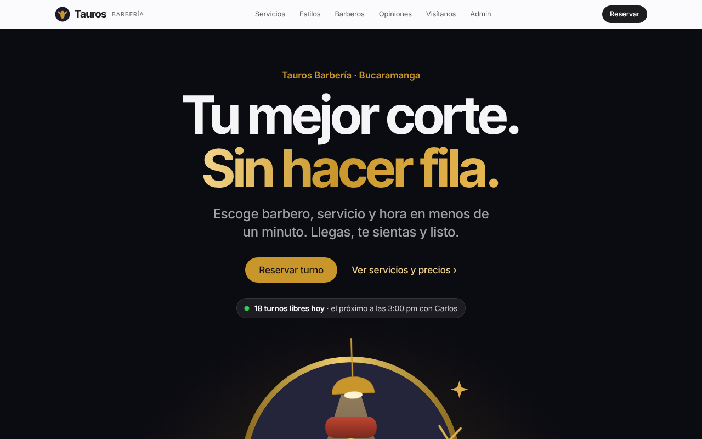

---

## Contenido

- [El problema](#el-problema)
- [La solución](#la-solución)
- [Capturas](#capturas)
- [Funcionalidades](#funcionalidades)
- [Arquitectura](#arquitectura)
- [Modelo de datos](#modelo-de-datos)
- [Tecnologías](#tecnologías)
- [Estructura del proyecto](#estructura-del-proyecto)
- [Instalación y despliegue](#instalación-y-despliegue)
- [Seguridad](#seguridad)
- [Accesibilidad y animaciones](#accesibilidad-y-animaciones)
- [Decisiones técnicas y problemas resueltos](#decisiones-técnicas-y-problemas-resueltos)
- [Pruebas realizadas](#pruebas-realizadas)
- [Trazabilidad de requisitos](#trazabilidad-de-requisitos)
- [Encuesta de opinión](#encuesta-de-opinión-módulo-aparte)
- [Mejoras futuras](#mejoras-futuras)

---

## El problema

Tauros Barbería, en el centro de Bucaramanga, agendaba sus citas **de forma manual**: por teléfono, por mensaje o en persona. Eso causaba:

- **Doble reserva:** dos clientes con el mismo barbero a la misma hora.
- **Falta de visibilidad:** el cliente no podía saber desde su casa qué horas había libres.
- **Carga operativa:** el administrador perdía tiempo coordinando cada cita.
- **Pérdida de clientes:** fuera del horario de atención nadie podía agendar.

## La solución

Una aplicación web con dos módulos:

| Módulo cliente (`/`) | Módulo administrador (`/admin`) |
|---|---|
| Ve los barberos, servicios y precios | Entra con correo y contraseña |
| Ve en tiempo real las horas libres | Ve la agenda del día por barbero, en tiempo real |
| Reserva en 5 pasos, sin crear cuenta | Marca citas como atendidas o canceladas |
| Recibe un comprobante con número de reserva | Gestiona barberos, sillas, horarios y servicios |

## Capturas

| Servicios y precios | Barberos |
|---|---|
| 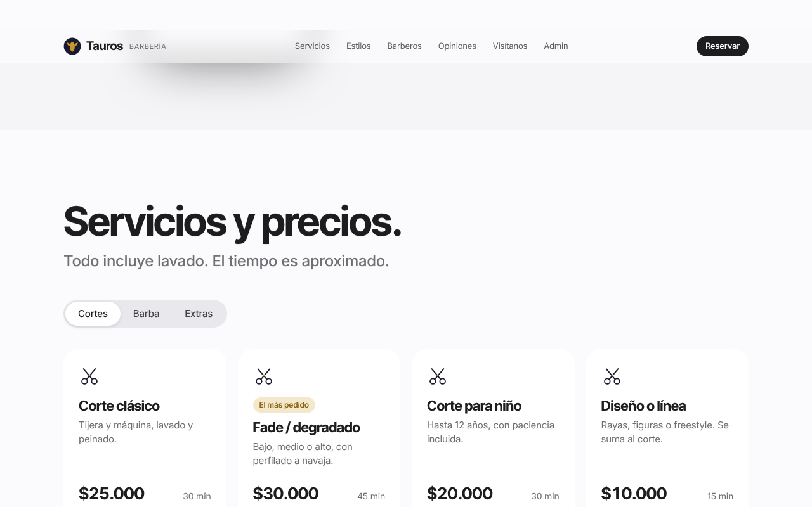 | 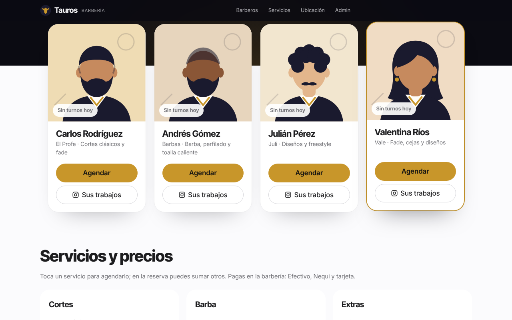 |

| Reserva: elegir día y hora | En el celular |
|---|---|
| 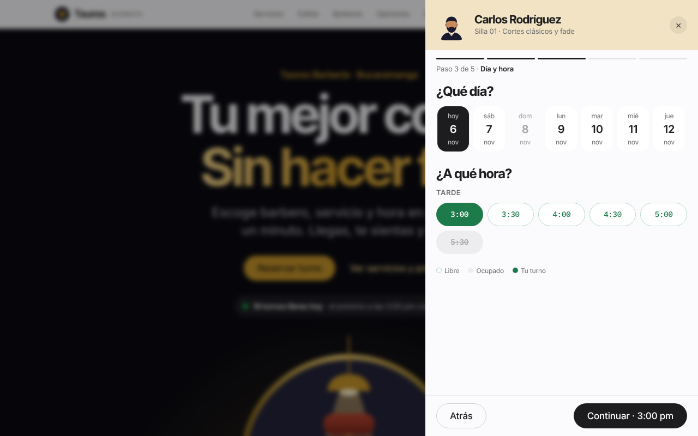 | 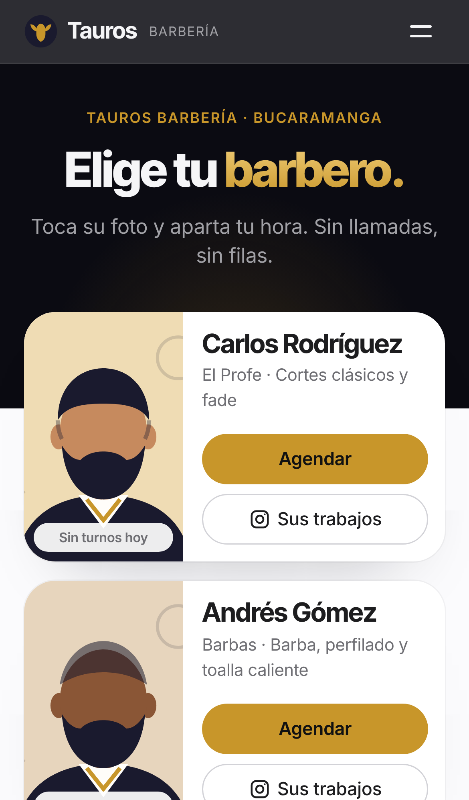 |

| Panel: acceso | Panel: agenda del día |
|---|---|
| 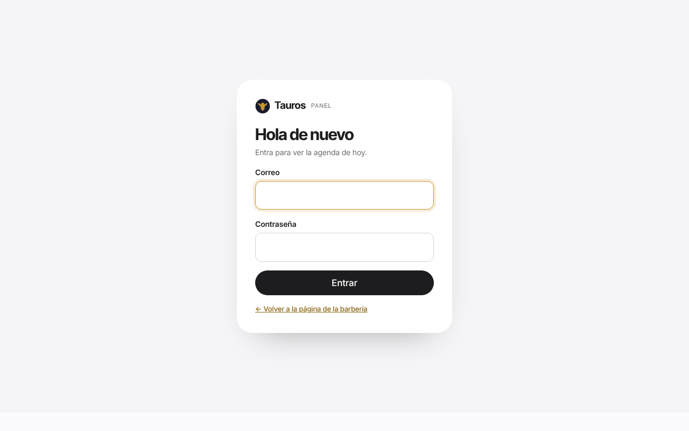 | 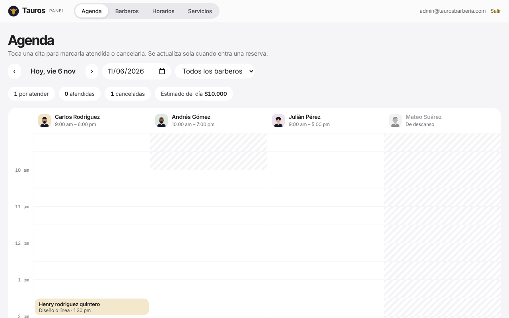 |

| Panel: barberos | Panel: horarios |
|---|---|
| 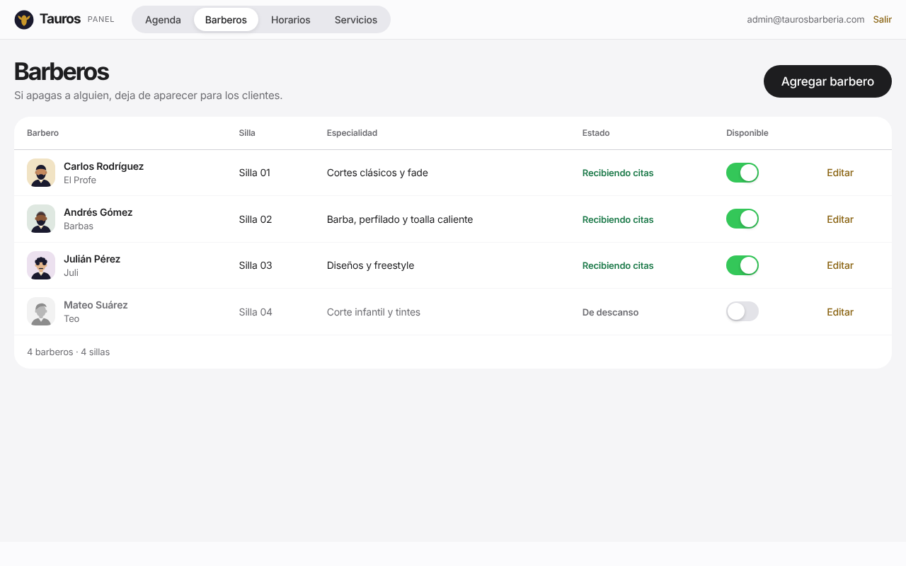 | 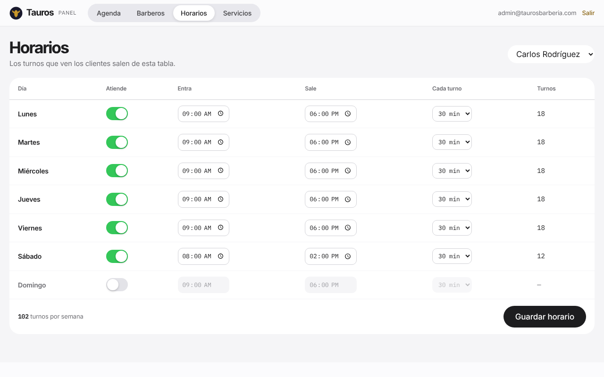 |

🎬 **Video de demostración narrado (4:23, Full HD):** [`docs/demo-tauros.mp4`](docs/demo-tauros.mp4)

## Funcionalidades

### Módulo cliente
- Portada simple, **sin ruido**: lo primero que ve el cliente son los **barberos con su foto** y si tienen turno hoy.
- **Tocar la foto (o "Agendar") abre la reserva** directamente con ese barbero.
- Botón **"Sus trabajos"** que lleva al **Instagram de cada barbero** (se configura desde el panel; requiere la migración `migraciones/02-instagram.sql`).
- **Servicios y precios** en una carta sencilla por categoría (cortes, barba, extras) con duración; tocar un servicio abre la reserva con ese servicio.
- **Ubicación y horario** con mapa de Google Maps que solo se carga si el cliente lo pide, y botón "Cómo llegar".
- **Reserva en pasos:** barbero → servicios → día → hora → datos.
  - Se pueden **combinar hasta 4 servicios** en una misma cita (ej. corte + cejas): la cita dura la suma y el total se ve antes de confirmar (migración `03-varios-servicios.sql`).
  - Horas **libres en verde** y **ocupadas en gris**.
  - Solo se ofrecen horas donde el servicio **cabe completo** (un "Corte + barba" ocupa 60 minutos).
  - Nombre y **celular colombiano obligatorios**, con formato automático (300 123 4567).
  - **Autorización de tratamiento de datos** antes de confirmar.
  - Sin pago ni registro.
- **Comprobante** en pantalla con número de reserva.
- Diseño **responsive** pensado primero para celular, con barra fija para reservar.

### Módulo administrador
- Acceso con **Supabase Auth** (correo y contraseña). Solo entran los usuarios autorizados.
- **Agenda del día** en columnas por barbero, con navegación por fecha, filtro por barbero y estimado de ingresos.
- La agenda **se actualiza sola** cuando un cliente reserva, con un aviso en pantalla.
- **Citas:** marcar como atendida o cancelar (al cancelar, el turno vuelve a quedar libre).
- **Barberos:** registrar, editar, asignar silla (o crear una nueva) y activar o desactivar.
- **Horarios:** días, hora de entrada y salida y duración del turno, por barbero.
- **Servicios:** cambiar precio, duración y visibilidad.

## Arquitectura

Arquitectura de tres capas **sin servidor propio** (JAMstack): el navegador se comunica directamente con la API de Supabase, y la seguridad la garantiza la base de datos con reglas por fila.

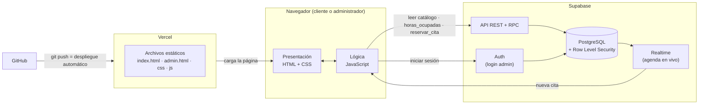

## Modelo de datos

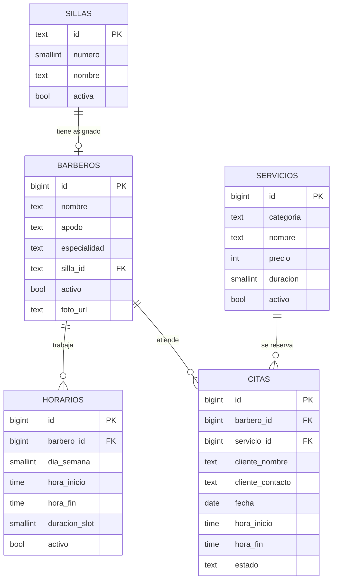

Además existe la tabla `admins`, que indica qué usuarios de Supabase Auth pueden entrar al panel.

## Tecnologías

| Tecnología | Uso |
|---|---|
| **HTML5** | Estructura de las páginas |
| **CSS3** | Diseño visual y responsive (Grid, Flexbox), animaciones |
| **JavaScript (ES2017)** | Lógica del cliente sin frameworks |
| **Supabase** | Base de datos PostgreSQL, API, inicio de sesión y tiempo real |
| **GitHub** | Control de versiones |
| **Vercel** | Publicación con despliegue automático en cada `git push` |

## Estructura del proyecto

```
tauros-barberia-app/
├── index.html          Página del cliente
├── admin.html          Panel de administración (se abre en /admin)
├── css/
│   └── estilos.css     Estilos compartidos
├── js/
│   ├── config.js       URL y clave pública de Supabase + datos del negocio
│   ├── ui.js           Utilidades de fechas, ilustraciones, confeti y avisos
│   ├── api.js          Toda la comunicación con Supabase
│   ├── cliente.js      Página pública y flujo de reserva
│   └── admin.js        Panel del administrador
├── img/logo.svg
├── docs/
│   ├── capturas/       Capturas de pantalla
│   └── demo-tauros.mp4 Video de demostración
├── privacidad.html     Política de tratamiento de datos (Ley 1581)
├── encuesta/           Encuesta de opinión del sitio (módulo aparte)
├── supabase.sql        Tablas, reglas de seguridad, funciones y datos iniciales (instalación nueva)
├── migraciones/
│   ├── 01-seguridad.sql         Actualiza una base ya creada con la versión anterior
│   ├── 02-instagram.sql         Instagram de cada barbero
│   └── 03-varios-servicios.sql  Varios servicios en una misma cita (ej. corte + cejas)
└── vercel.json         URLs limpias (/admin) y cabeceras de seguridad
```

## Instalación y despliegue

### 1. Base de datos (Supabase)
1. Crea un proyecto en [supabase.com](https://supabase.com).
2. En **SQL Editor → New query**, pega todo el contenido de [`supabase.sql`](supabase.sql) y presiona **Run**.
3. En **Authentication → Users → Add user**, crea el usuario administrador (marca *Auto Confirm User*).
4. Conviértelo en administrador desde el **SQL Editor** (cambia el correo):
   ```sql
   insert into public.admins (user_id)
   select id from auth.users where email = 'tu-correo@ejemplo.com';
   ```
5. En **Authentication → Sign In / Providers**, desactiva **Allow new users to sign up**.
6. En **Project Settings → API**, copia la *Project URL* y la *publishable key* y ponlas en [`js/config.js`](js/config.js).

### 2. Probar en tu computador
Abre la carpeta en Visual Studio Code y usa la extensión **Live Server** sobre `index.html`. El panel está en `admin.html`.

### 3. Publicar (GitHub + Vercel)
1. Sube el código a un repositorio de GitHub.
2. En [vercel.com](https://vercel.com) → **Add New → Project** → importa el repositorio. *Framework Preset*: **Other**, sin comando de build.
3. En **Settings → Deployment Protection**, desactiva *Vercel Authentication* para que el sitio sea público.
4. Cada `git push` a `main` publica una versión nueva automáticamente.

> Las credenciales del administrador **no se guardan en el repositorio**. Pídeselas al equipo del proyecto.

## Seguridad

### Base de datos (Supabase)
- **Row Level Security** en todas las tablas. Un visitante solo puede **leer** barberos, sillas, horarios y servicios.
- El visitante **no puede ver** nombres ni teléfonos de otros clientes: la disponibilidad se consulta con `horas_ocupadas()`, que solo devuelve horas.
- Las reservas solo entran por `reservar_cita()`, que **valida todo en el servidor**:
  - nombre y celular colombiano válido,
  - autorización de datos,
  - fecha futura,
  - barbero activo y horario del barbero,
  - que no se cruce con otra cita.
- **Freno contra abuso:**
  - máximo **2 citas pendientes por celular**,
  - un bloqueo por número para evitar trampas con dos clics simultáneos,
  - un límite global de reservas cada 10 minutos.
- **Doble reserva imposible:** una restricción de exclusión (`citas_sin_cruce`) rechaza en la base de datos dos citas que se crucen.
- Solo los usuarios de la tabla `admins` pueden modificar datos o ver citas. `es_admin()` no está disponible para visitantes anónimos.
- Registro público de usuarios **desactivado**. La contraseña del admin exige **mínimo 10 caracteres con mayúsculas, minúsculas y números**, y se puede cambiar desde el panel.
- La extensión `btree_gist` vive en el esquema `extensions`, no en `public`, como recomienda Supabase.

### Sitio web (Vercel)
- **HTTPS** obligatorio con **HSTS**.
- **Content-Security-Policy:** solo se permite cargar código propio, la librería de Supabase, las fuentes de Google y el mapa de Google Maps (maps.google.com; único iframe permitido, y solo se carga si el usuario toca «Ver mapa»). Se bloquean objetos y formularios hacia otros sitios.
- **Subresource Integrity (SRI):** la librería `supabase-js` se carga con su huella `sha384`. Si el CDN la alterara, el navegador no la ejecutaría.
- Cabeceras `X-Frame-Options: DENY`, `X-Content-Type-Options`, `Referrer-Policy`, `Permissions-Policy` y `Cross-Origin-Opener-Policy`.
- El panel `/admin` va con `noindex` (no aparece en Google) y `no-store` (no se guarda en caché).
- Todo texto que viene de la base de datos se **escapa** antes de mostrarse, como protección contra XSS. No hay JavaScript en línea.
- La clave de `config.js` es la **publishable key**, pública por diseño. Nunca se usa la clave *secret / service_role* en el código.

### Datos personales (Ley 1581 de 2012)
- Antes de reservar, el cliente marca una **casilla de autorización** que enlaza a la [política de privacidad](https://tauros-barberia-app.vercel.app/privacidad). Se guarda la fecha y hora de la autorización.
- Solo se piden **nombre y celular**, lo mínimo necesario.
- La política explica la finalidad, los derechos del titular (conocer, actualizar, rectificar, suprimir, revocar), el canal para ejercerlos y el tiempo de conservación.

### Análisis de seguridad de Supabase
| Aviso | Estado |
|---|---|
| Extensión en el esquema público | ✅ Corregido |
| `es_admin()` ejecutable por anónimos | ✅ Corregido |
| `reservar_cita()` y `horas_ocupadas()` son `SECURITY DEFINER` | ℹ️ **Intencional:** son la única puerta controlada del visitante; validan todo y no exponen datos personales |
| Protección contra contraseñas filtradas (HaveIBeenPwned) | ⚠️ Solo disponible en el plan Pro de Supabase |

**Recomendado para producción real:** plan Pro de Supabase (contraseñas filtradas y copias de seguridad diarias), autenticación de dos factores para el administrador y CAPTCHA en el formulario de reserva.

## Accesibilidad y animaciones

Siguiendo las pautas **WCAG 2.2**:
- **2.2.2 Pausar, detener, ocultar:** botón **"Pausar animaciones"** en la portada y en el pie de página. Detiene todo lo que se mueve solo (lámpara, destellos, indicador en vivo) y se recuerda en el navegador.
- **2.3.3 Animación por interacción:** si el sistema tiene activado *reducir movimiento*, se desactivan las animaciones, el efecto de profundidad al hacer scroll, el desplazamiento suave y el confeti.
- **2.3.1 Destellos:** ninguna animación parpadea más de 3 veces por segundo.
- Las animaciones usan solo `transform` y `opacity` (no mueven el resto de la página), duran entre 0,2 y 1 segundo, y **el contenido es visible aunque no se animen**.
- **2.4.1 Saltar bloques:** enlace "Saltar al contenido" con la tecla Tab.
- **2.1.2 y 2.4.3 Foco:** en las ventanas de reserva y del panel, el foco del teclado queda dentro de la ventana, avanza al contenido de cada paso y vuelve al botón de origen al cerrar. Se cierra con Esc.
- **Formularios:** etiquetas visibles, campos obligatorios marcados, errores anunciados al lector de pantalla (`aria-live`) y campos con error resaltados (`aria-invalid`).
- Contraste alto, foco visible y botones de al menos 40 px en el celular.

## Decisiones técnicas y problemas resueltos

1. **Supabase es relacional (PostgreSQL), no NoSQL.** El documento del proyecto proponía colecciones JSON. Se modelaron como tablas con los mismos campos, más relaciones y validaciones.
2. **Condición de carrera (doble reserva).** En lugar de solo verificar antes de guardar, la tabla `citas` tiene una restricción de exclusión (`citas_sin_cruce`) que impide que un barbero tenga dos citas que se crucen en el tiempo. Si dos clientes confirman a la vez, la base de datos acepta una y rechaza la otra, y la página le pide al segundo que elija otra hora.
3. **Variables de entorno en un sitio estático.** Un sitio HTML/JS sin paso de compilación no puede leer las variables de entorno de Vercel. La clave pública va en `config.js` y la seguridad se garantiza con RLS.
4. **Acceso del administrador.** En vez de una contraseña escrita en el código, que cualquiera podría ver, se usa Supabase Auth con un usuario real y la tabla `admins`.
5. **Duración por servicio.** Se agregó la tabla `servicios`, que en el documento era una mejora futura. Así un "Corte + barba" ocupa 60 minutos y el sistema solo ofrece horas donde cabe completo.
6. **Silla y barbero.** La relación se guarda solo en `barberos.silla_id` para que nunca quede desincronizada.
7. **Publicación.** El primer despliegue en Vercel no se había generado (error 404) y la protección de Vercel pedía iniciar sesión. Se lanzó el despliegue y se desactivó la protección para que el sitio fuera público.

## Pruebas realizadas

| Caso | Resultado esperado | Resultado |
|---|---|---|
| Reservar un turno libre | La cita se guarda y aparece el comprobante | ✅ |
| Dos reservas que se cruzan (mismo barbero y hora) | Se acepta una y la otra recibe `HORARIO_OCUPADO` | ✅ |
| Reservar después de la hora de salida del barbero | Rechazada con `FUERA_DE_HORARIO` | ✅ |
| Reservar con un barbero desactivado | Rechazada con `BARBERO_NO_DISPONIBLE` | ✅ |
| Reservar en una fecha u hora pasada | Rechazada con `FECHA_INVALIDA` | ✅ |
| Confirmar sin nombre | Mensaje de validación en el formulario | ✅ |
| Celular inválido o vacío | `CONTACTO_INVALIDO` y mensaje en el campo | ✅ |
| Reservar sin marcar la autorización de datos | `AUTORIZACION_REQUERIDA` | ✅ |
| Tercera cita pendiente con el mismo celular | `LIMITE_RESERVAS` | ✅ |
| Visitante anónimo llama `es_admin()` | Permiso denegado | ✅ |
| Librería de Supabase alterada en el CDN | El navegador no la ejecuta (SRI) | ✅ |
| Sitio publicado bajo la CSP | Sin bloqueos ni errores en consola; tiempo real funciona | ✅ |
| Pausar animaciones / *reducir movimiento* del sistema | Animaciones detenidas | ✅ |
| Navegación solo con teclado en la reserva | El foco no se escapa de la ventana | ✅ |
| Visitante intenta ver las citas de otros | No ve ninguna | ✅ |
| Visitante intenta modificar un barbero | No cambia nada | ✅ |
| Login con contraseña incorrecta | Mensaje "Correo o contraseña incorrectos" | ✅ |
| Usuario con sesión que no es admin | No puede ver ni modificar datos | ✅ |
| Desactivar un barbero en el panel | Desaparece de las opciones del cliente | ✅ |
| Cambiar horario o precio en el panel | La página del cliente lo refleja | ✅ |
| Vista en celular (390 px) | Sin desbordes horizontales | ✅ |

## Trazabilidad de requisitos

| Requisito | Dónde se cumple |
|---|---|
| RF-01 Visualizar sillas | Sección "Conoce a los de la casa" · `cliente.js` |
| RF-02 Seleccionar silla | Paso 1 de la reserva |
| RF-03 Elegir fecha | Paso 3: solo días con horario del barbero |
| RF-04 Horarios disponibles | Paso 4: verde libre, gris ocupado · `horas_ocupadas()` |
| RF-05 Reservar cita | Paso 5 · `reservar_cita()` con validaciones |
| RF-06 Confirmación | Comprobante con número de reserva |
| RF-07 Acceso al panel | `/admin` con Supabase Auth + tabla `admins` |
| RF-08 Registrar barberos | Panel → Barberos → Agregar barbero |
| RF-09 Listar barberos | Panel → Barberos |
| RF-10 Gestionar horarios | Panel → Horarios |
| RF-11 Ver citas | Panel → Agenda (filtros por fecha y barbero) |
| RF-12 Estado del barbero | Interruptor de disponibilidad |
| RNF-01 Usabilidad | Flujo guiado de 5 pasos, sin registro |
| RNF-02 Responsive | Diseño pensado primero para celular |
| RNF-03 Rendimiento | Sin frameworks ni compilación; carga directa |
| RNF-04 Disponibilidad | Vercel + Supabase |
| RNF-05 Seguridad | HTTPS + HSTS + CSP + SRI + RLS + Auth + límites anti-abuso + Ley 1581 |
| RNF-06 Mantenibilidad | Código separado por archivos y comentado |
| RNF-07 Compatibilidad | Chrome, Edge, Firefox y Safari actuales |
| RNF-08 Escalabilidad | Sillas, barberos y servicios se agregan desde el panel, sin tocar código |

## Encuesta de opinión (módulo aparte)

En la carpeta [`encuesta/`](encuesta/) hay una encuesta anónima para que el público califique el sitio. **No modifica nada de la aplicación de la barbería**: tiene sus propias páginas, estilos, código y tabla en la base de datos.

- **Responder:** [tauros-barberia-app.vercel.app/encuesta](https://tauros-barberia-app.vercel.app/encuesta): estrellas, facilidad de uso, si lo usarían, qué les gustó y un comentario opcional.
- **Resultados en vivo:** [tauros-barberia-app.vercel.app/encuesta/resultados](https://tauros-barberia-app.vercel.app/encuesta/resultados): promedio y gráficas que se actualizan cada 5 segundos. Los comentarios solo los ve el administrador.
- **Base de datos:** [`encuesta/encuesta.sql`](encuesta/encuesta.sql) crea la tabla `encuesta_respuestas` y dos funciones (`enviar_opinion` y `resultados_encuesta`). No se guardan datos personales.

## Mejoras futuras

- Recordatorios por WhatsApp o correo.
- Pagos en línea.
- Cuentas de cliente para ver o cancelar sus propias citas.
- Panel de estadísticas (demanda por hora, barbero más solicitado).
- Fotos reales de los barberos y opiniones reales de clientes.

---

> **Nota:** los nombres de barberos, precios, dirección, teléfono, cifras y opiniones son **datos de ejemplo** para el proyecto académico.
